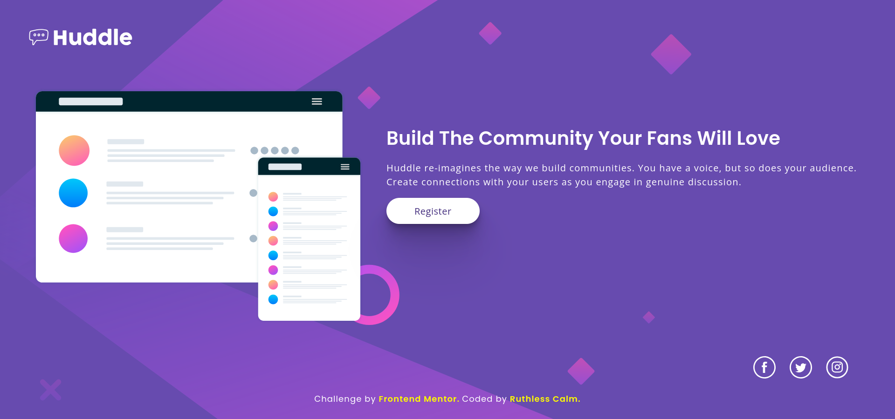

# Huddle Landing Page

This is one of my Frontend Mentor challenge projects.

## Links 

This is challenge - [Huddle landing page](https://www.frontendmentor.io/challenges/huddle-landing-page-with-a-single-introductory-section-B_2Wvxgi0) if you want to check out their challenges.
- Live Demo: [Huddle Landing Page](https://ruthlesscalm.github.io/fm-huddle-landing-page/)

## Preview

- **Desktop** 

- **Mobile** 

## Features

- Fully fluid and responsive layout (280px to 1920px)
- Web-accessible (focus states , semantic Html , screen reader friendly)

## Tech Stacks

- HTML
- CSS

## Credits /  References

- [Joshua Comeau](https://www.joshwcomeau.com/)
    - [Shadow pallete](https://www.joshwcomeau.com/shadow-palette/)
    - [Box shadow techniques](https://www.joshwcomeau.com/css/designing-shadows/)
    - [Modern CSS Reset](https://www.joshwcomeau.com/css/custom-css-reset/)
- [Picallili - Andy Bell](https://piccalil.li/author/andy-bell/)
    - [Modern CSS Reset](https://piccalil.li/blog/a-more-modern-css-reset/)
- [Tobias Ahlin Bjerrome](https://tobiasahlin.com/)
    - [Box shadow techniques](https://tobiasahlin.com/blog/layered-smooth-box-shadows/)

## License

This project is licensed under the [MIT License](./LICENSE).  
Feel free to use the code for learning, experimentation, or reference.
